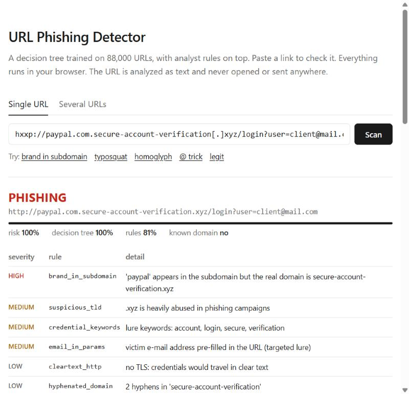
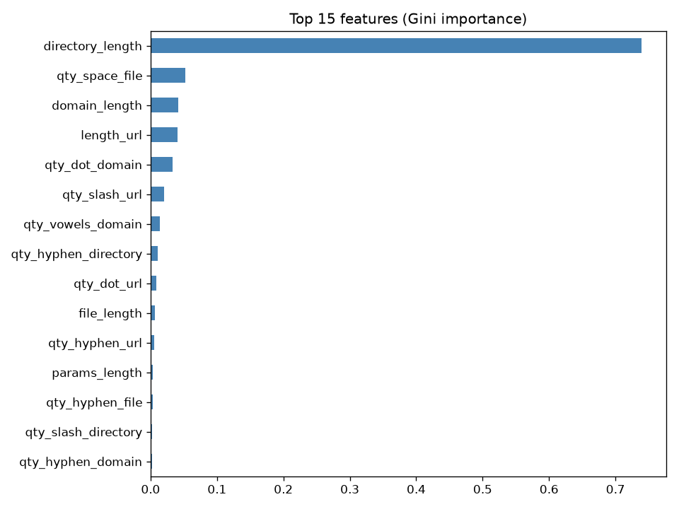

# URL Phishing Detector

Phishing URL triage built around a **decision tree classifier** (scikit-learn), with an analyst rule
layer on top. Paste a URL (or a list, or a whole `.eml`). You get a verdict, a risk score, the indicators
that fired, and the exact path the tree took to reach its decision.

**Live demo: https://redakarrach.github.io/URLPhishingDetector/** (runs fully in your browser, the URL is
never contacted)



```
$ python -m phishdetect scan "hxxps://paypa1[.]com/signin"
PHISHING   risk 100.0%  (tree 100% | rules 78%)  https://paypa1.com/signin
    [critical] typosquat            paypa1.com imitates paypal.com (edit distance 1)
    [low     ] credential_keywords  lure keywords: signin
```

## Why

Scenario: in one week, several employees clicked links leading to fake login portals (a fake bank page, a fake
Microsoft 365 page). The SOC wants a model that flags suspicious URLs automatically, **and** the analysts need
to be able to read and audit the rules it uses. A black box that says "92% phishing" doesn't help anyone
write a ticket or defend a block.

ATT&CK: [T1566.002](https://attack.mitre.org/techniques/T1566/002/) Spearphishing Link,
[T1204.001](https://attack.mitre.org/techniques/T1204/001/) Malicious Link,
[T1583.001](https://attack.mitre.org/techniques/T1583/001/) Acquire Infrastructure: Domains.

## The AI part: a decision tree

The core of the detector is a supervised machine learning model: a **decision tree classifier**.

- **What it learns.** From 88,647 labelled URLs (30,647 phishing, 58,000 legit), the tree learns a sequence of
  yes/no questions on URL features, for example `directory_length > 1.5`, `qty_dot_domain <= 1.5`,
  `length_url > 37.5`. A URL goes from the root to a leaf, and the leaf returns the share of phishing URLs that
  landed there during training. That share is the model's probability.
- **How it picks the questions.** At each node it tries every feature and threshold, and keeps the split that
  reduces **Gini impurity** the most: `1 - p_legit² - p_phish²` (0 = pure group, 0.5 = 50/50).
- **Why a tree.** It's explainable. Every verdict comes with its decision path (`--explain`), which an analyst
  can verify by hand. A neural network or a 500-tree forest would score a bit higher and explain nothing.
- **Overfitting.** An unconstrained tree memorizes the training set (near 100% train accuracy, worse on new
  data). Too shallow and it underfits. `GridSearchCV` tried 36 combinations of `max_depth`,
  `min_samples_leaf` and `criterion` (gini / entropy) with 5-fold cross-validation, optimizing F1 on the
  phishing class. Winner: gini, depth 12, 913 leaves, train accuracy 0.942 vs test 0.928.
- **Features.** The dataset stores 111 numbers per URL, not the URL itself. `features.py` rebuilds the
  85 non-constant columns that can be computed from the URL text alone (character counts and lengths for
  the domain, path, file and query), so the trained tree can score new links.

### Results (test set, 17,442 URLs)

| Features | Accuracy | Precision | Recall | F1 | FPR |
|---|---|---|---|---|---|
| 26 URL-text columns (original notebook) | 0.926 | 0.908 | 0.877 | 0.892 | 4.8% |
| **85 lexical columns (shipped model)** | **0.928** | **0.919** | **0.870** | **0.894** | **4.2%** |
| + WHOIS / DNS / HTTP columns | 0.955 | 0.941 | 0.931 | 0.936 | 3.2% |

The network features add about 4 F1 points, but they need to query the attacker's infrastructure (slow,
unreliable, and it tips them off). A filter that decides at click time only has the URL text. The full model
is kept as a benchmark only.

**Threshold by error cost.** A missed phish (stolen credentials, lateral movement) costs much more than a
false block (a helpdesk ticket). With FN = 20 × FP, the cheapest threshold is 0.1 (recall 96%), but that means
15% of legit traffic blocked. So the tree is used as one input to a score, not as a hard block.

### What the tree got wrong



`directory_length` alone carries **74%** of the importance, so the first question is basically "does the
URL have a path?". It's a dataset artifact: legit samples are mostly homepages (`google.com`) and phishing
samples are mostly deep links (`fake.xyz/login/verify.php`). Splitting the test set shows it:

| Subgroup | URLs | Recall | FPR |
|---|---|---|---|
| no path | 9,313 | **0.026** | 0.0003 |
| with path | 8,129 | 0.893 | **0.214** |

Phishing hosted at the root of a domain is **missed 97% of the time**, and 21% of legit pages with a path
get flagged. The 93% accuracy hides that, which is why the tree doesn't decide alone.

## Analyst rules

`heuristics.py` covers what character counts can't capture:

| Rule | Severity | Example |
|---|---|---|
| `userinfo_trick` | critical | `https://www.google.com@evil.tld/` |
| `typosquat` | high / critical | `paypa1.com`, `rnicrosoft.com` (edit distance after folding look-alikes) |
| `homoglyph` | critical | `xn--pple-43d.com` renders as Cyrillic `аpple.com` |
| `dangerous_scheme`, `double_extension` | critical | `javascript:`, `invoice.pdf.exe` |
| `brand_in_subdomain` / `brand_in_domain` | high | `paypal.com.account-check.xyz`, `secure-netflix-billing.com` |
| `ip_host`, `open_redirect`, `executable_download` | high | `http://10.0.0.5/login`, `?redirect=https://...` |
| `free_hosting`, `url_shortener`, `suspicious_tld`, `email_in_params`, ... | medium | 000webhost, bit.ly, `.xyz`, `?user=victim@corp` |
| `credential_keywords`, `cleartext_http`, `long_url`, ... | low | weak signals, only count when combined |

Brands include the usual targets (Microsoft 365, PayPal, Apple, DHL...) and Moroccan banks (Attijariwafa,
CIH, Bank of Africa, Al Barid Bank, CMI).

**Scoring**

```
risk = 1 - (1 - p_tree) × (1 - p_rules)        p_rules = noisy-OR of rule weights

PHISHING    risk ≥ 0.70 and at least one medium+ rule agrees
SUSPICIOUS  risk ≥ 0.40, or the tree alone is confident ("model_only")
CLEAN       otherwise; known-good domains ignore the tree score unless a high/critical rule fires
```

## Usage

```bash
git clone https://github.com/RedaKarrach/URLPhishingDetector.git
cd URLPhishingDetector
pip install -r requirements.txt
```

The trained model is in the repo, so you can scan right away:

```bash
python -m phishdetect scan <url> [<url> ...] [--explain] [--json] [--defang]
python -m phishdetect scan -f urls.txt -o report.csv      # batch, CSV or JSON report
python -m phishdetect interactive                         # paste URLs one by one
python -m phishdetect eml suspicious.eml                  # headers + every link of a reported mail
python -m phishdetect serve                               # local web UI + API on 127.0.0.1:8080
python -m phishdetect features <url>                      # dump the extracted features
```

- Defanged IOCs work as input (`hxxps://evil[.]com`). Use `--defang` for ticket-safe output.
- `eml` checks Reply-To / Return-Path / display name spoofing and SPF / DKIM / DMARC, then extracts links
  from text and HTML and flags **display text ≠ real target** (`<a href="http://evil">https://outlook.office365.com</a>`).
- Exit code `2` when something is flagged PHISHING, for scripting.
- `--allowlist file.txt` adds your own trusted domains.
- API: `GET /api/scan?url=...`, `POST /api/scan {"urls": [...]}`.

Nothing is ever resolved or fetched: no DNS, no WHOIS, no HTTP to the analyzed URL.

### Retrain

Get `dataset_full.csv` (see [`data/README.md`](data/README.md)), then:

```bash
python -m phishdetect train --data data/dataset_full.csv                  # ~1-2 min, writes model + reports/
python -m phishdetect train --data data/dataset_full.csv --features full --no-save
python -m phishdetect export-web                                          # refresh the GitHub Pages demo
```

## Limitations

- **Dataset bias** (above), and the data is from 2020. Kits and TLD abuse have moved since.
- **Feature reconstruction is approximate**: the dataset's extraction code isn't public. Edge cases like
  `qty_tld_url` may differ slightly.
- **No page content**: a kit on a compromised legit domain only gets the tree score and path keywords.
- **Static lists** (brands, TLDs, shorteners, hosters) need maintenance. Rule weights are hand-tuned. The
  dataset has no raw URLs, so only the tree has measured metrics, not the combined engine.
- `registered_domain()` uses a short suffix list, not the full Public Suffix List.

Next steps: PSL, optional threat-intel lookups (URLhaus, OpenPhish), a raw-URL dataset to evaluate the
combined engine, Random Forest / gradient boosting comparison.

## Layout

```
phishdetect/   features.py, heuristics.py, detector.py, train.py, mail.py, web.py, cli.py
models/        url_tree.joblib (trained tree)
reports/       metrics, tree rules, plots for each feature set
docs/          GitHub Pages demo (JS port of the engine + exported tree)
lab/           original Colab notebook
examples/      sample URL list and phishing e-mail
tests/         pytest, including a JS / Python parity test for the demo
```

## Dataset

G. Vrbančič, I. Fister Jr., V. Podgorelec, *Datasets for phishing websites detection*, Data in Brief 33
(2020) 106438. [Mendeley Data](https://data.mendeley.com/datasets/72ptz43s9v).

---

Reda Karrach. For educational and defensive use. The malicious-looking URLs in this repo are made up.
