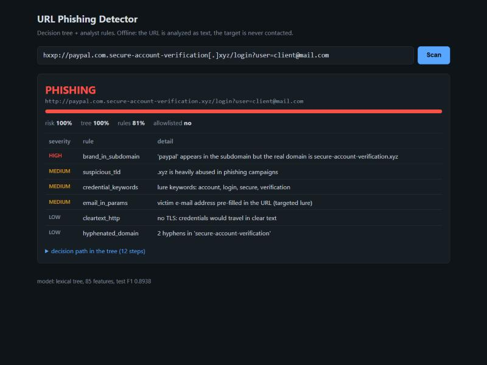

# URL Phishing Detector

Phishing URL triage tool built around a **decision tree classifier** (scikit-learn), with an
analyst rule layer on top. It started as LAB_02 of the *AI for Cybersecurity* module
(EMSI, 5CIRA) and was extended into a tool a SOC analyst can actually run against reported links.

You paste a URL (or a list of URLs, or a whole `.eml` file), it gives you a verdict, a risk score, the
indicators that fired, and the exact path the tree took to reach its decision.

```
$ python -m phishdetect scan "hxxp://paypal.com.secure-account-verification[.]xyz/login?user=client@mail.com"
PHISHING   risk 100.0%  (tree 100% | rules 81%)  http://paypal.com.secure-account-verification.xyz/login?user=client@mail.com
    [high    ] brand_in_subdomain   'paypal' appears in the subdomain but the real domain is secure-account-verification.xyz
    [medium  ] suspicious_tld       .xyz is heavily abused in phishing campaigns
    [medium  ] credential_keywords  lure keywords: account, login, secure, verification
    [medium  ] email_in_params      victim e-mail address pre-filled in the URL (targeted lure)
    [low     ] cleartext_http       no TLS: credentials would travel in clear text
    [low     ] hyphenated_domain    2 hyphens in 'secure-account-verification'
```



---

## Context

Scenario from the lab: in one week, several employees clicked links leading to fake login portals
(a fake bank page, a fake Microsoft 365 page). The SOC lead wants a model that flags suspicious URLs
automatically, and wants to be able to **read and audit the rules** the model uses.

That last requirement is why the model is a decision tree and not a black box. Every verdict can be
explained as a chain of `if feature <= threshold` tests that an analyst can check by hand.

Relevant ATT&CK techniques:
[T1566.002 Spearphishing Link](https://attack.mitre.org/techniques/T1566/002/),
[T1204.001 User Execution: Malicious Link](https://attack.mitre.org/techniques/T1204/001/),
[T1583.001 Acquire Infrastructure: Domains](https://attack.mitre.org/techniques/T1583/001/).

## What it does

| Feature | Command |
|---|---|
| Scan one or more URLs | `scan <url> ...` |
| Batch scan a list and export a CSV/JSON report | `scan -f urls.txt -o report.csv` |
| Interactive mode (paste URLs one by one) | `interactive` |
| Triage a reported e-mail: headers + every link | `eml message.eml` |
| Local web UI + JSON API | `serve` |
| Explain a verdict (tree decision path) | `scan <url> --explain` |
| Dump the 98 lexical features of a URL | `features <url>` |
| Retrain the tree, regenerate reports | `train --data data/dataset_full.csv` |

Other details:

- Accepts **defanged IOCs** as input (`hxxps://evil[.]com`, `[:]`, `(.)`) and can defang output (`--defang`)
  so reports can be pasted into tickets without creating clickable links.
- **Fully offline**: no DNS, WHOIS, or HTTP request is ever made to the analyzed URL. You don't tip off the
  operator, don't hit a tracking pixel, and don't download a payload.
- Exit code `2` when at least one URL is flagged PHISHING, so it can be chained in scripts.

## Quick start

```bash
git clone https://github.com/RedaKarrach/URLPhishingDetector.git
cd URLPhishingDetector
pip install -r requirements.txt
```

A trained model (`models/url_tree.joblib`) is already in the repo, so you can scan right away:

```bash
python -m phishdetect scan google.com "hxxp://192.168.12[.]7/banque/connexion.php"
python -m phishdetect interactive
python -m phishdetect serve          # http://127.0.0.1:8080
```

## Usage

### Single URL / several URLs

```bash
python -m phishdetect scan https://paypa1.com/signin --explain
```

```
PHISHING   risk 100.0%  (tree 100% | rules 78%)  https://paypa1.com/signin
    [critical] typosquat            paypa1.com imitates paypal.com (edit distance 1)
    [low     ] credential_keywords  lure keywords: signin
    decision path:
      -> directory_length = 7 > 1.50
      -> qty_dot_domain = 1 <= 1.50
      -> length_url = 17 <= 25.50
      -> file_length = 6 <= 6.50
      ...
      -> domain_length = 10 <= 10.50
      -> leaf #904: 100% of training URLs here were phishing
```

### Batch

```bash
python -m phishdetect scan -f examples/urls.txt -o report.csv --defang
cat proxy_export.txt | python -m phishdetect scan -f - --json
```

The CSV has `url, verdict, risk, tree_probability, heuristic_score, trusted_domain, findings`.

### Interactive

```
$ python -m phishdetect interactive
url> hxxps://login-office365[.]support/owa/?redirect=https://evil.tk
PHISHING   risk 99.6%  (tree 98% | rules 80%)  https://login-office365.support/owa/?redirect=https://evil.tk
    [high    ] brand_in_domain      'office365' embedded in login-office365.support, which is not an official office365 domain
    [high    ] open_redirect        parameter 'redirect' forwards to another URL
    [medium  ] suspicious_tld       .support is heavily abused in phishing campaigns
    [low     ] credential_keywords  lure keywords: login
url> :explain on
url> :features https://evil.tk/a.php?x=1
url> :q
```

### Reported e-mail (.eml)

```bash
python -m phishdetect eml examples/suspicious_mail.eml
```

The message is parsed, never rendered. The tool:

- checks the headers: `Reply-To` / `Return-Path` diverging from `From`, a display name claiming a brand
  sent from an unrelated domain, a lookalike sender domain, SPF / DKIM / DMARC failures
- extracts every link from the text and HTML parts (`href`, `src`, form `action`) and deduplicates them
- flags **display text / real target mismatches** (`<a href="http://evil">https://outlook.office365.com</a>`)
- scans each link and gives a verdict for the whole message

```
header analysis:
    [high    ] reply_to_mismatch    replies go to gmail.com, not to the sender domain micros0ft-support.top
    [high    ] display_name_spoof   display name claims 'Microsoft 365' but mail comes from micros0ft-support.top
    [high    ] sender_brand_in_domain sender domain: 'microsoft' embedded in micros0ft-support.top, ...
    [high    ] dmarc_fail           DMARC result: fail
...
    [high    ] display_mismatch     link text shows 'https://outlook.office365.com/verify' but points elsewhere
message verdict: PHISHING
```

### Web UI / API

```bash
python -m phishdetect serve --port 8080
curl "http://127.0.0.1:8080/api/scan?url=hxxp://bit[.]ly/3xYz9Q"
curl -X POST http://127.0.0.1:8080/api/scan -d '{"urls": ["google.com", "http://10.0.0.5/login.php"]}'
```

Binds to `127.0.0.1` by default. The page reflects attacker-controlled strings by design, so all output is
HTML-escaped, a strict `Content-Security-Policy` is sent, and request bodies are size-limited.

### Own allowlist

```bash
python -m phishdetect --allowlist my_domains.txt scan -f urls.txt
```

One domain per line (`intranet.company.ma`, `company.ma`...).

---

## How detection works

```
            URL (raw or defanged)
                    |
                 refang
                    |
      +-------------+---------------+
      |                             |
 lexical features (98)        analyst rules (25+)
 same columns as the          brand abuse, typosquat,
 training dataset             homoglyph, IP host, ...
      |                             |
 decision tree                noisy-OR of rule weights
 p_tree = phishing share      h in [0, 1]
 in the leaf
      |                             |
      +-------------+---------------+
                    |
       risk = 1 - (1 - p_tree)(1 - h)
                    |
   allowlist + corroboration checks -> CLEAN / SUSPICIOUS / PHISHING
```

### 1. Lexical features

The dataset doesn't store URLs, only numbers computed from them. `phishdetect/features.py` rebuilds the
same columns from a raw URL so the trained tree can be used on new links. The URL is split the same way
as in the dataset (scheme stripped):

```
secure-bank.com/account/login.php?id=7
\_____________/\________________/ \__/
     domain         directory      params
                          \_______/
                            file
```

For each part: counts of 17 special characters (`. - _ / ? = @ & ! ~ , + * # $ %` and space), lengths, plus
`domain_in_ip`, `qty_vowels_domain`, `qty_tld_url`, `qty_params`, `tld_present_params`, `email_in_url`,
`url_shortened`. A missing part is `-1`, as in the dataset.

The 13 columns that need network lookups (domain age, DNS, TLS, Google index, redirects...) are **not used
by the scanner** on purpose, see [Results](#results).

### 2. Decision tree

Training follows the lab methodology (`phishdetect/train.py`):

1. drop duplicate rows (88,647 -> 87,209) and the 13 constant columns
2. stratified 80/20 split, `random_state=42`
3. `GridSearchCV` on the training set only: `max_depth` {6, 8, 10, 12, 15, None} x `min_samples_leaf`
   {1, 5, 20} x `criterion` {gini, entropy}, 5-fold CV, optimizing **F1 on the phishing class**
4. evaluation on the held-out test set
5. cost analysis: decision thresholds 0.1 to 0.9, where a missed phish costs 20x a false block
6. error analysis per subgroup (URLs with / without a path)

The tree outputs `p_tree`: the share of phishing URLs among the training samples in the leaf the URL lands in.

### 3. Analyst rules

`phishdetect/heuristics.py`. These cover what character counts can't capture, and they give the analyst a
reason they can act on.

| Rule | Severity | What it catches |
|---|---|---|
| `dangerous_scheme` | critical | `javascript:`, `data:`, `vbscript:`, `file:` |
| `userinfo_trick` | critical | `https://www.google.com@evil.tld/` (the real host is after the `@`) |
| `typosquat` | high / critical | edit distance to a brand domain, after folding look-alikes (`rn`->`m`, `0`->`o`, `1`->`l`) |
| `homoglyph` | critical | punycode host that renders as a brand (`xn--pple-43d.com` = Cyrillic `аpple.com`) |
| `double_extension` | critical | `invoice.pdf.exe` |
| `ip_host` | high | raw IPv4 / IPv6 / hex / decimal host |
| `brand_in_subdomain` / `brand_in_domain` | high | `paypal.com.account-check.xyz`, `secure-netflix-billing.com` |
| `open_redirect` | high | `?redirect=https://...`, `?url=`, `?next=` |
| `executable_download` | high | `.exe .scr .js .hta .iso .lnk .apk ...` |
| `brand_in_path` | medium | brand name in the path of an unrelated or free-hosted site |
| `free_hosting` | medium | 000webhost, firebaseapp, pages.dev, ngrok, sites.google.com ... |
| `url_shortener` | medium | the real destination is hidden |
| `suspicious_tld` | medium | `.xyz .top .icu .zip .mov .tk ...` |
| `idn_host` | medium | internationalized hostname with no brand match |
| `email_in_params` | medium | victim address pre-filled: a sign of a targeted campaign |
| `deep_subdomains`, `non_standard_port`, `embedded_url`, `high_entropy_domain` | medium | |
| `credential_keywords`, `cleartext_http`, `hyphenated_domain`, `long_url`, `heavy_encoding`, `digits_in_domain` | low | weak signals, only matter when combined |

The brand list includes the usual global targets (Microsoft 365, PayPal, Apple, DHL...) and Moroccan banks
(Attijariwafa, CIH, Bank of Africa, Al Barid Bank, CMI) since those are the lures that show up locally.

Severity weights: low 0.10, medium 0.25, high 0.45, critical 0.75, combined as
`h = 1 - prod(1 - w_i)`.

### 4. Verdict

- `risk >= 0.70` -> **PHISHING**, `>= 0.40` -> **SUSPICIOUS**, otherwise **CLEAN**
- **Corroboration**: a PHISHING verdict needs at least one medium-or-higher rule. If only the tree is
  confident, the URL is downgraded to SUSPICIOUS with a `model_only` note (reason below).
- **Allowlist**: if the registrable domain is a known-good domain or an official brand domain, and no
  high/critical rule fired, the tree score is ignored. Free hosting under a big domain
  (`sites.google.com`, `github.io`...) is never allowlisted, since anyone can publish there.

---

## Results

Test set: 17,442 URLs, never used for model selection.

| Feature set | Features | Accuracy | Precision | Recall | F1 | FPR | FNR |
|---|---|---|---|---|---|---|---|
| `lab26` (URL text, lab step 14) | 26 | 0.9259 | 0.9076 | 0.8774 | 0.8922 | 4.8% | 12.3% |
| **`lexical` (shipped model)** | 85 | **0.9276** | **0.9185** | **0.8703** | **0.8938** | **4.2%** | **13.0%** |
| `full` (with WHOIS / DNS / HTTP) | 98 | 0.9552 | 0.9407 | 0.9305 | 0.9355 | 3.2% | 7.0% |

Shipped tree: gini, `max_depth=12`, `min_samples_leaf=1`, 913 leaves, train accuracy 0.942 vs test 0.928
(small gap, not much overfitting). Baseline to beat: always answering "legit" gives ~65%.

The network features add about 4 F1 points, but they cost latency, can fail, and querying the attacker's
infrastructure is an OPSEC problem. A filter that decides at click time only has the URL text, which is what
`lexical` models. `full` is kept as a benchmark (`train --features full`), not as a scanning model.

Confusion matrix (lexical, test set):

|  | predicted legit | predicted phishing |
|---|---|---|
| **legit** | 10,872 | 471 (blocked by mistake) |
| **phishing** | 791 (missed) | 5,308 |

### Choosing the threshold by error cost

A false negative means an employee types their password on a fake page: account takeover, lateral
movement, maybe ransomware. A false positive means a ticket to the helpdesk. With FN = 20 x FP:

| threshold | FP | FN | recall | precision | cost |
|---|---|---|---|---|---|
| **0.1** | 1,695 | 233 | 0.962 | 0.776 | **6,355** |
| 0.2 | 1,324 | 321 | 0.947 | 0.814 | 7,744 |
| 0.3 | 846 | 509 | 0.917 | 0.869 | 11,026 |
| 0.5 | 480 | 779 | 0.872 | 0.917 | 16,060 |
| 0.7 | 330 | 997 | 0.837 | 0.939 | 20,270 |

With that cost ratio the cheapest option is to block aggressively (0.1). In practice a 15% false
positive rate on browsing traffic would get the tool disabled by users within a week, which is why the
scanner uses the tree as one input among others and not as a hard blocking threshold.

### What the tree actually learned (and why the rule layer exists)


`directory_length` alone carries **74%** of the importance. The first split is basically "does the URL
have a path?". That is a **dataset artifact**: most legit URLs in the dataset are homepages (`google.com`),
and most phishing URLs are deep links (`fake-site.xyz/login/verify.php`).

The global score hides it. Split the test set:

| Subgroup | URLs | phishing share | accuracy | recall | FPR |
|---|---|---|---|---|---|
| no path (`directory_length = -1`) | 9,313 | 1.7% | 0.983 | **0.026** | 0.0003 |
| with path | 8,129 | 73.1% | 0.864 | 0.893 | **0.214** |

- A phishing page served **at the root of a domain** is missed **97% of the time**. An attacker who knows
  this just has to host the kit at `/`.
- **21%** of legit URLs that have a path (a Wikipedia article, an intranet page, a shop product page) are
  flagged.

So 93% accuracy hides a model that is weak on exactly the cases that matter. This is why the
tool doesn't trust the tree alone:

- rules like `brand_in_subdomain`, `typosquat`, `homoglyph` or `ip_host` don't depend on the path at all,
  so they catch root-hosted kits
- a tree-only alert is capped at SUSPICIOUS (`model_only`), and allowlisted domains ignore the tree score

Full reports for each feature set (metrics JSON, tree rules as text, confusion matrix, top of the tree)
are in [`reports/`](reports/).

---

## Limitations

These are known gaps, written down so nobody over-trusts the output:

- **Dataset bias**: see above. Legit data is mostly homepages, collected around 2020. Phishing kits,
  TLD abuse and hosting habits have changed since.
- **Feature reconstruction is approximate**: the dataset authors didn't publish their extraction code.
  `features.py` matches their documented definitions and the value ranges in the CSV, but edge cases
  (`qty_tld_url`, how `qty_params` is counted) may differ slightly.
- **No content analysis**: a compromised legit site (WordPress `/wp-content/uploads/xx/login.html` on a
  real company domain) only gets the tree score and the path keywords. The rules can't see the page.
- **Allowlist abuse**: an open redirect on a trusted domain (`google.com/url?q=https://evil...`) is caught
  by `open_redirect` only when the target is a full URL in a known redirect parameter. Encoded or
  chained redirects get through as CLEAN.
- **Static lists**: brands, suspicious TLDs, shorteners and free hosters are hard-coded. They need
  maintenance, or a feed.
- **Rule weights are hand-tuned**, not learned. The dataset has no raw URLs, so the combined engine can't be
  evaluated on it. Only the tree has measured metrics.
- `registered_domain()` uses a short list of second-level suffixes (`co.uk`, `co.ma`...), not the full
  Public Suffix List.

Possible next steps: Public Suffix List, threat-intel feed lookups (OpenPhish, URLhaus) as an optional
online mode, a dataset with raw URLs (PhiUSIIL) to measure the combined engine, a Random Forest /
gradient boosting comparison, and a browser extension or proxy (ICAP) integration.

## OPSEC notes

- Never open a reported link in your normal browser to "check it". Use this tool, then a sandbox.
- Share IOCs defanged (`--defang`).
- `serve` listens on localhost only. If you expose it to a team, put it behind auth and a reverse proxy.

---

## Project layout

```
phishdetect/
  features.py     URL -> dataset columns, refang/defang
  heuristics.py   analyst rules, brand / TLD / hosting lists
  detector.py     scoring engine, verdict, decision path
  train.py        lab pipeline: dedup, grid search, metrics, cost table, subgroups
  mail.py         .eml parsing, header checks, link extraction
  web.py          local web UI + JSON API (stdlib only)
  cli.py          command line
models/url_tree.joblib     trained tree (lexical, 85 features)
reports/{lab26,lexical,full}/   metrics.json, tree_rules.txt, plots
lab/UrlPhishingDetector_ArbreDec.py   original lab notebook (Colab export)
examples/       sample URL list and a sample phishing e-mail
tests/          pytest
```

Retrain (about 1 to 2 minutes):

```bash
python -m phishdetect train --data data/dataset_full.csv                     # lexical, overwrites the model
python -m phishdetect train --data data/dataset_full.csv --features full --no-save
python -m phishdetect train --data data/dataset_full.csv --cost-fn 50       # change the FN/FP cost ratio
```

Tests:

```bash
pip install -r requirements-dev.txt
python -m pytest -q
```

## Dataset

G. Vrbančič, I. Fister Jr., V. Podgorelec, *Datasets for phishing websites detection*, Data in Brief 33
(2020) 106438. [Mendeley Data](https://data.mendeley.com/datasets/72ptz43s9v). See [`data/README.md`](data/README.md).

## Author

Reda Karrach, 5CIRA, EMSI. *AI for Cybersecurity* module, LAB_02.

For educational and defensive use. The example "malicious" URLs in this repo are made up, and they are
defanged where it matters.
